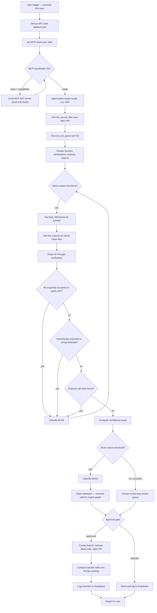

# Phantom.js — The Ghost Hunter

> An enterprise-grade FinOps & codebase-analysis agent that hunts **zombie code** (dead, unreferenced functions) and **vampire dependencies** (packages draining cloud compute), then opens automated PRs to exorcise them.

**Stack:** Next.js (App Router) · TypeScript · Tailwind · Supabase (exorcism audit log) · Vercel · MCP (Model Context Protocol) over a local Node.js AST server.

---

## 1. System Architecture

The system is a **state machine**. The agent never touches the filesystem directly — it can only call vetted, read-only tools exposed by the MCP server. The only write path (PR generation) is gated behind human approval.



### Stage-by-stage

| Stage | What happens | Safety property |
|---|---|---|
| **Trigger** | User hits `/api/exorcise` with `repoPath` and `dryRun`. | `dryRun` defaults to `true`; no mutation possible by accident. |
| **MCP handshake** | Next.js spawns the local AST server over stdio and exchanges `initialize` + `tools/list`. | Client learns the *exact, finite* capability set. Unknown tools cannot be invented. |
| **Context retrieval** | Agent calls `list_source_files` + `run_ast_parser` to build the suspect inventory. | Both tools are read-only. |
| **Tool execution (AST)** | `find_references` scans the codebase; `list_exports` checks barrel files. | Read-only; bounded to source dirs (excludes `node_modules`, `dist`, `.next`). |
| **Chain-of-Thought** | Agent reasons per suspect: *is this referenced? dynamically imported? re-exported? string-reflected?* | CoT is logged to Supabase for audit. |
| **State validation** | Confidence score + deterministic policy guards produce a `dead / uncertain / alive` verdict. | Guards can **veto** the LLM — the model cannot override them. |
| **Approval gate** | `dead` + `uncertain` both require sign-off before any PR. | Human-in-the-loop is the last line against false positives. |
| **PR generation** | Branch → remove dead code → commit → open PR. | Never pushes to `main`; fully reversible (close PR + delete branch). |
| **FinOps + log** | Bundle delta computed, savings projected, exorcism row written to Supabase. | Every action is auditable and replayable. |

---

## 2. Agentic Workflow & Advanced AI Features

### The core loop: think → act → observe → validate

```
PLAN   : "Given utils/, enumerate every function declaration and decide a verdict per function."
ACT    : call run_ast_parser(file)            -> functions[]
OBSERVE: each function has {name, isExported, startLine, endLine, kind}
ACT    : call find_references(name, repoRoot)  -> references[]
       : call list_exports(index files)        -> reexportedBy[]
THINK  : Chain-of-Thought over the false-positive vectors (below)
VALID  : apply deterministic guards -> verdict + confidence
LOOP   : next suspect
BATCH  : group dead functions into a removal plan -> approval gate -> PR
```

### Evaluating a massive `utils/` directory

A real `utils/` folder can hold hundreds of functions. The agent does **not** reason over raw text — it operates over structured AST facts, which keeps the context window bounded:

1. **Enumerate cheaply** — `list_source_files` returns the file set; `run_ast_parser` returns a compact JSON list of `{name, isExported, kind, lines}` per file. No source code enters the prompt unless a specific function needs scrutiny.
2. **Batch the cheap signal** — `find_references` returns a *count* and *classified kinds* (`import`, `call`, `dynamic-import`, `string-literal`, `other`). The agent triages on counts first: `referenceCount > 0` → likely alive.
3. **Escalate only the suspects** — for functions with zero direct references, the agent runs the full CoT (below) and, if needed, fetches the surrounding source lines of a handful of candidate matches for a *targeted* look.

### Chain-of-Thought: "dead" vs "dynamically imported"

A function with zero static call sites is **not** automatically dead. The agent must rule out each false-positive vector before classifying it dead. The CoT is an explicit checklist:

> *Suspect `formatCurrency` in `utils/format.ts:12-30`. Exported=true. References found: 0.*
> *Step 1 — Static references: 0 call sites outside its declaration.*
> *Step 2 — Barrel re-export: `utils/index.ts` does not re-export `formatCurrency`. Not public API.*
> *Step 3 — Dynamic import: no `import('./format')` or `require('./format')` matches the symbol. Not lazy-loaded.*
> *Step 4 — String reflection: the name does not appear inside a string literal (rules out lookup tables like `handlers['formatCurrency']`).*
> *Step 5 — Public surface: not in `package.json` `exports`, not a default export, not a framework hook (`getServerSideProps`, route handlers).*
> *Conclusion: no reachable path invokes this function → verdict DEAD, confidence 0.8.*

The hard rules that **force ALIVE** (conservative by design):

| Signal | Verdict | Why |
|---|---|---|
| Re-exported by any barrel `index.*` | ALIVE | Public API — removing breaks consumers. |
| Appears inside `import(...)` / `require(...)` | ALIVE | Dynamically loaded at runtime. |
| Appears inside a string literal | ALIVE | Possible reflection / lookup map. |
| Any external call site | ALIVE | Referenced code is live by definition. |

Only when **all** vectors are clean does the agent compute a confidence score and classify:

- Not exported, zero references → **DEAD** (high confidence).
- Exported but zero references → **UNCERTAIN** (could be intended public API) → human review.

### Why AST over regex

Naive dead-code detectors grep for the symbol name and get buried in false positives (comments, substrings, shadowed locals). AST gives:

- **Exact declarations** (no comment false matches).
- **Export/async/default-export flags** that change the verdict.
- **Parameter counts** for sizing heuristics (large exported functions are riskier to delete).
- A clean JSON contract the LLM can reason about without ingesting megabytes of source.

---

## 3. Reliability Mechanisms & Evaluation Harness

### Reliability mechanisms

1. **Capability-scoped, read-only tool boundary.** The MCP server exposes exactly four tools — `list_source_files`, `run_ast_parser`, `find_references`, `list_exports`. There is **no** `delete_file`, `write_file`, `exec`, or `git` tool. By construction, the agent cannot mutate the repo it inspects. Mutation only happens in the gated PR step, in the Next.js layer.

2. **Transport isolation.** Reasoning (LLM) and tool execution (AST server) live in separate processes. A prompt-injection attempt in analyzed source code cannot reach the filesystem — it can only produce tool *calls*, which are constrained to read-only operations on vetted inputs.

3. **Deterministic policy guards that veto the LLM.** The agent proposes a verdict; the guard layer enforces. If `find_references` returns a `dynamic-import` or `string-literal` match, the verdict is forced to ALIVE regardless of what the model says. The model cannot talk its way past the rules.

4. **Three-tier classification with confidence thresholds.** `dead` / `uncertain` / `alive` with tunable thresholds (`DEAD_THRESHOLD = 0.7`, `UNCERTAIN_THRESHOLD = 0.3`). Exported-but-unreferenced functions land in `uncertain`, never auto-deleted.

5. **Human-in-the-loop approval gate.** Both `dead` and `uncertain` verdicts require sign-off before a PR is opened. The default mode is `dryRun`, which only produces a report.

6. **Reversibility.** PRs are branches — never a push to `main`. Rollback is "close PR + delete branch." No force-push, no history rewrite.

7. **Allowlist / never-flag rules.** Default exports, framework hooks (`getServerSideProps`, `generateMetadata`, route handler exports), `package.json` `exports` entries, and test helpers are never auto-flagged.

8. **Full audit log.** Every tool call, CoT step, verdict, and approval decision is written to Supabase with timestamps, enabling post-hoc review and regression analysis.

### Evaluation harness

Accuracy is measured as a **classification problem** against a golden dataset of repos with hand-verified dead/alive labels.

**Dataset.** Seed repos with deliberately injected dead code + real-world OSS snapshots. Each function is labeled `dead` or `alive` by a human. Adversarial cases are mandatory: dynamic imports, barrel re-exports, reflection maps, conditional `require`, env-gated code, test-only functions.

**Metrics.** Precision is the load-bearing metric — a false positive deletes live code, which is catastrophic.

```
TP = correctly flagged dead     FP = flagged dead but actually alive  (DANGEROUS)
FN = actually dead but missed    TN = correctly left alive

precision = TP / (TP + FP)      # minimize FP above all
recall    = TP / (TP + FN)
F1        = 2 * precision * recall / (precision + recall)
FPR       = FP / (FP + TN)      # false-positive rate
cost-weighted F1 = F1 with FP weighted 10x FN   # FinOps: deleting live code >> leaving dead code
```

**Harness flow.**

```
for repo in golden_dataset:
    report = runExorcism(repo, { dryRun: true })        # read-only
    predictions = verdicts(report)
    metrics += compare(predictions, labels)
emit { precision, recall, F1, FPR, costF1, perCategoryBreakdown }
```

**Regression policy.** The harness runs on every change. CI fails if `precision < 0.95` or `FPR > 0.02`. Per-category breakdown (dynamic-import cases, barrel cases, reflection cases) is tracked over time so a regression in one tricky category is visible even if the aggregate holds.

**Where it lives.** `npm run eval` (script below) runs the harness against `eval/fixtures/`. The fixtures directory is a set of small repos with a `labels.json` mapping `file:line -> dead|alive`.

---

## 4. Initial Code Implementation

### File map

```
PhantomJS/
├── ARCHITECTURE.md            ← this document
├── README.md
├── package.json               ← Next.js root + agent client deps
├── tsconfig.json
├── next.config.mjs
├── .env.example
├── mcp-server/                 ← local, read-only AST MCP server (separate process)
│   ├── package.json
│   ├── tsconfig.json
│   └── src/index.ts           ← list_source_files, run_ast_parser, find_references, list_exports
└── src/
    ├── app/api/exorcise/route.ts   ← Next.js API route: trigger + MCP connect
    └── lib/agent/
        ├── types.ts                ← shared verdict / suspect types
        ├── mcp-client.ts           ← stdio MCP client wrapper
        ├── agent-loop.ts           ← think-act-observe-validate loop + policy guards
        └── demo.ts                 ← run the agent from the CLI (no web UI needed)
```

### 4a. The MCP AST server (`mcp-server/src/index.ts`)

The foundational piece. It uses the TypeScript compiler API to parse `.ts/.tsx/.js/.jsx` in one pass and exposes four read-only tools. There is deliberately no write tool.

```typescript
import { McpServer } from "@modelcontextprotocol/sdk/server/mcp.js";
import { StdioServerTransport } from "@modelcontextprotocol/sdk/server/stdio.js";
import { z } from "zod";
import * as fs from "node:fs";
import * as path from "node:path";
import ts from "typescript";

const server = new McpServer({ name: "phantom-ast-server", version: "0.1.0" });

const text = (obj: unknown) => ({
  content: [{ type: "text" as const, text: JSON.stringify(obj, null, 2) }],
});

// run_ast_parser: parse a file -> function declarations (name, export/async flags, lines)
server.tool(
  "run_ast_parser",
  "Parse a .ts/.tsx/.js/.jsx file and return every function-like declaration with line ranges, export/async flags, and param counts. READ-ONLY.",
  { filePath: z.string() },
  async ({ filePath }) => { /* ...parseSource + extractFunctions... */ return text({ /* ... */ }); },
);

// find_references: whole-codebase textual scan, classified by kind
server.tool(
  "find_references",
  "Scan the codebase (excl. node_modules/dist/.next) for a symbol and classify each match as import/call/dynamic-import/string-literal/other. READ-ONLY.",
  {
    symbol: z.string(),
    searchRoot: z.string(),
    sourceFile: z.string().optional(),
  },
  async ({ symbol, searchRoot, sourceFile }) => { /* ... */ return text({ /* ... */ }); },
);

// list_exports: exported symbols + re-exports (barrel detection)
server.tool(
  "list_exports",
  "List exported values/types/re-exports in a file. Detects barrel `export *` that keep a function alive. READ-ONLY.",
  { filePath: z.string() },
  async ({ filePath }) => { /* ... */ return text({ /* ... */ }); },
);

// list_source_files: enumerate the scan set so the agent never touches the FS itself
server.tool(
  "list_source_files",
  "List .ts/.tsx/.js/.jsx files under a root, excluding node_modules/dist/.next. READ-ONLY.",
  { searchRoot: z.string() },
  async ({ searchRoot }) => { /* ... */ return text({ /* ... */ }); },
);

const transport = new StdioServerTransport();
await server.connect(transport);
```

The full file (with the AST walker, reference classifier, and error handling) is in `mcp-server/src/index.ts`.

### 4b. The MCP client (`src/lib/agent/mcp-client.ts`)

A thin wrapper that spawns the server over stdio, completes the handshake, and exposes `listTools` + `callTool`. The agent talks to the repo **only** through this client.

```typescript
import { Client } from "@modelcontextprotocol/sdk/client/index.js";
import { StdioClientTransport } from "@modelcontextprotocol/sdk/client/stdio.js";
import * as path from "node:path";

const SERVER_ENTRY = path.join(process.cwd(), "mcp-server", "dist", "index.js");

export async function connectPhantomServer() {
  const transport = new StdioClientTransport({ command: "node", args: [SERVER_ENTRY] });
  const client = new Client({ name: "phantom-agent", version: "0.1.0" }, { capabilities: {} });
  await client.connect(transport);
  return {
    async listTools() { return (await client.listTools()).tools.map((t) => t.name); },
    async callTool<T>(name: string, args: Record<string, unknown>) {
      const res = await client.callTool({ name, arguments: args });
      const block = res.content?.find((c) => c.type === "text");
      if (!block || block.type !== "text") throw new Error(`Tool ${name} returned no text`);
      return JSON.parse(block.text) as T;
    },
    async close() { await transport.close(); },
  };
}
```

### 4c. The agent loop (`src/lib/agent/agent-loop.ts`)

Implements think → act → observe → validate. The deterministic policy guards live alongside the LLM CoT — in production the model proposes the verdict; the guards enforce it. The foundational version runs the guards directly so the agent is fully functional without an LLM API key, and the reasoning trace is emitted as a CoT log.

```typescript
export async function runExorcism(repoPath: string, opts: { dryRun?: boolean; onProgress?: (m: string) => void } = {}) {
  const mcp = await connectPhantomServer();
  const { files } = await mcp.callTool("list_source_files", { searchRoot: root });
  for (const file of files) {
    const { functions } = await mcp.callTool("run_ast_parser", { filePath: file });
    for (const fn of functions) {
      const { references, referenceCount } = await mcp.callTool("find_references", { symbol: fn.name, searchRoot: root, sourceFile: file });
      const reexportedBy = await detectBarrelReexports(mcp, fn.name, file, indexFiles);
      const cot = buildChainOfThought(fn, references, reexportedBy);
      const { verdict, confidence } = classify(fn, referenceCount, reexportedBy, references);
      suspects.push({ ...fn, referenceCount, reexportedBy, verdict, confidence, reasoningTrace: cot });
    }
  }
  await mcp.close();
  return { dead, uncertain, alive };   // dryRun by default — no mutation
}
```

### 4d. The Next.js API route (`src/app/api/exorcise/route.ts`)

```typescript
import { NextRequest, NextResponse } from "next/server";
import { runExorcism } from "@/lib/agent/agent-loop";

export const runtime = "nodejs";   // stdio subprocess needs Node, not edge
export const maxDuration = 60;

export async function POST(req: NextRequest) {
  const { repoPath, dryRun = true } = await req.json();
  if (!repoPath) return NextResponse.json({ error: "repoPath required" }, { status: 400 });
  const logs: string[] = [];
  const report = await runExorcism(repoPath, { dryRun, onProgress: (m) => logs.push(m) });
  return NextResponse.json({ ok: true, report, logs });
}
```

### Running it

```bash
# 1. Install + build the read-only MCP server (produces mcp-server/dist/index.js)
npm run mcp:build

# 2. Install root deps
npm install

# 3a. Run the agent against a repo from the CLI (no web UI needed)
npm run agent:demo -- ./path/to/repo

# 3b. Or start Next.js and POST to /api/exorcise
npm run dev
#   curl -X POST localhost:3000/api/exorcise -H "Content-Type: application/json" \
#        -d '{"repoPath":"./path/to/repo","dryRun":true}'
```

> **Production note on transport.** stdio is perfect for the local hackathon demo because the agent and the AST server run in the same machine. On Vercel serverless you cannot spawn a long-lived stdio subprocess — swap `StdioServerTransport` / `StdioClientTransport` for the **Streamable HTTP** transport and host the AST server as a small HTTP service (or run the agent in a queue worker). The tool surface and the agent loop are unchanged; only the wire changes. This transport-agnosticism is exactly what MCP buys you (see §5).

---

## 5. Hackathon Pitch & Documentation

### The one-liner

> **Phantom.js is the FinOps agent that turns "dead code" and "unused dependencies" into a measurable cloud-cost line item — and autonomously opens the PR to remove them.**

### Talking point 1 — The FinOps impact is real and quantifiable

"Vampire dependencies" aren't a vanity metric; they map directly to cloud spend:

- **Build minutes.** Every unused dependency still gets installed on every CI build. Slower installs → more build-minutes → hitting Vercel/CI plan limits sooner → forced upgrade. Trimming `node_modules` shrinks install time and build minutes directly.
- **Cold starts.** Serverless/Edge cold-start time scales with bundle size. A smaller bundle = faster cold starts = fewer compute-seconds per invocation. At millions of invocations across many functions, the savings compound.
- **Deploy artifact limits.** Vercel Edge Functions cap at ~4 MB, Node functions at ~250 MB unzipped. Vampire deps push you toward those limits, forcing architecture changes you didn't budget for.
- **Security-surface cost.** Unused deps still get installed, scanned, and triaged for CVEs. Removing them shrinks the CVE backlog and the license-compliance surface — a real SecOps/FinOps lever.

**Illustrative FinOps math (clearly an estimate, shown live in the PR description):**

```
removedBundleKB   = Σ size of exorcised dead code + removed deps
coldStartDeltaMs  ≈ removedBundleKB / 50 KB/ms      (rule of thumb; tunable)
monthlyInvocations = N
extraComputeSeconds = coldStartDeltaMs/1000 * N     (cold-start frequency-weighted)
projectedSavingsUSD = extraComputeSeconds * pricePerGbSecond * memoryGb
```

Every exorcism row in Supabase stores `removedBundleKB`, `coldStartDeltaMs`, and `projectedSavingsUSD`, so FinOps can sum the trend over time. Phantom.js makes "codebase hygiene" a **reportable FinOps metric**, not a vibes-based refactor.

### Talking point 2 — Decoupling reasoning from tool execution via MCP is the breakthrough

This is the architectural thesis of the project:

1. **Security by capability scoping.** The LLM never gets filesystem or shell access. It can only call a *finite, vetted* set of read-only tools. A prompt-injection attempt hiding in analyzed source code can, at worst, produce a read-only tool call — it cannot delete a file or open a PR. The blast radius is the tool surface, full stop.

2. **Auditability.** Every action is a discrete, logged MCP RPC. You get a full trace of *which tool the model called, with what arguments, at what time*. CoT and tool calls are persisted to Supabase. The agent's behavior is replayable and reviewable — essential for enterprise adoption.

3. **Composability.** The same AST server serves any MCP-compatible client — Claude, a custom agent, an IDE, a CLI. Write the tools once, reuse everywhere. The agent loop is independent of the tool implementation.

4. **Portability / future-proofing.** Swap the LLM (Claude → GPT → local model) without touching the tools. Swap the tools (TS compiler → Babel → tree-sitter) without touching the agent. The MCP contract is the seam.

5. **Separation of concerns done right.** *Judgment* (is this function really dead?) lives in the LLM. *Mechanics* (parse this file, search for this symbol) live in the sandboxed server. Each does what it's good at. This is the same principle that makes databases safer than `eval()` — you don't hand the model the keyboard, you hand it a query language.

### Talking point 3 — Reliability is a first-class feature, not an afterthought

- **Three-tier verdicts** (dead / uncertain / alive) + **confidence thresholds** — the agent is allowed to say "I don't know," and uncertain cases route to humans.
- **Deterministic guards that veto the LLM** — dynamic-import and reflection detection override the model's verdict. The model cannot self-authorize a deletion.
- **Read-only by construction** — there is no write tool to exploit.
- **Evaluation harness with a precision-first metric** and a cost-weighted F1 that penalizes false positives 10x, run as a CI regression gate. Phantom.js doesn't claim accuracy; it **measures** it.

### Demo script (60 seconds)

1. "Here's a repo with a `utils/` full of functions — some alive, some dead, one loaded by dynamic import."
2. `npm run agent:demo -- ./demo-repo` — watch the handshake, the scan, the CoT per suspect.
3. "Notice the dynamically-imported function is classified ALIVE, the unreferenced private helper is DEAD, the exported-but-unreferenced one is UNCERTAIN — routed to a human."
4. "Default is dry-run: zero mutation. Approve → branch + PR opened, with the bundle delta and projected savings in the description."
5. "Open Supabase — the exorcism is logged with the full CoT trace, for audit and regression."

---

## Appendix — Configuration notes

- **Steering / hooks:** none required for the MVP. If wiring a `post-exorcism` hook, place it in `.kiro/hooks/` and have it write the FinOps summary back to Supabase.
- **Env:** `.env.example` lists `PHANTOM_REPO_PATH`, `SUPABASE_URL`, `SUPABASE_ANON_KEY`, `ANTHROPIC_API_KEY`. The agent runs fully on the deterministic guards without `ANTHROPIC_API_KEY`; the key is only needed to drive the CoT from a real LLM.
- **Eval harness (TODO scaffold):** `npm run eval` runs `eval/run.ts` over `eval/fixtures/*/labels.json`. Implementation follows the metrics block in §3.
