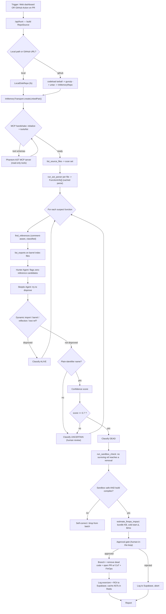

# Phantom.js — The Ghost Hunter

> An enterprise-grade **FinOps & codebase-analysis agent** that scans GitHub repositories to hunt **zombie code** (dead, unreferenced functions) and **vampire dependencies** (bloated packages draining bundle size and cloud compute), runs a Hunter→Skeptic→Sandbox trial, and opens verified PRs ("exorcisms") with projected cost savings.

**Stack:** Next.js (App Router) · TypeScript · Tailwind CSS · React Flow (call graph) · Supabase (audit log) · Redis (AST cache) · Vercel · **MCP** (Model Context Protocol) with a transport-agnostic Node.js AST server.

**Status:** builds clean, type-checks, and runs end-to-end — including a real scan of a public GitHub repo (`anthropics/anthropic-sdk-typescript/src`: 362 files → 1363-node / 5011-edge call graph) and a local sample repo with the hard cases (dynamic import, barrel re-export) classified correctly.

---

## 0. Deployment & public-repo scanning (how this is actually wired)

Two things had to be true for this to ship to Vercel and scan public repos:

1. **No stdio subprocess on the serverless function.** Vercel functions can't spawn long-lived stdio children. So the agent runs the MCP server **in-process** via `InMemoryTransport.createLinkedPair()` — a linked client+server in the same Node process. The protocol contract is unchanged; only the wire is in-memory. The same `createPhantomServer(repoSource)` factory also boots over stdio when run standalone (`node mcp-server/dist/index.js`), so the decoupled-server demo still works locally. **One tool surface, transport-agnostic.**

2. **No `git clone`, no disk.** Public repos are fetched as a tarball from `codeload.github.com`, gunzipped + untarred in memory into an `InMemoryRepo` (a `Map<path, content>`). Both local and GitHub scans go through one `RepoSource` interface (`LocalDiskRepo` | `InMemoryRepo`), so the agent loop, the MCP tools, and the call graph are identical for both.

Single-SDK-instance correctness is enforced by building the server against the root's hoisted deps (`mcp:build = tsc -p mcp-server`, no nested `node_modules`), so the `McpServer` and `Client` are the same class. `typescript` (used at runtime to parse ASTs) is a **production** dependency so Vercel bundles it into the function.

---

## 1. Dedicated Homepage (Landing Page)

`src/app/page.tsx` — a single client component, cyberpunk/terminal dark theme (obsidian background, terminal green `#00fa00` for alive, neon purple `#c084fc` for zombies, amber `#f59e0b` for uncertain, glassmorphism cards via `backdrop-blur` + `bg-white/5`).

- **Hero** — bold headline, value prop, a primary CTA input ("Paste a GitHub repo URL") wired to `POST /api/hunt`, and a stylized **Haunted Call Graph preview** (inline SVG) shown before the first hunt.
- **Feature grid** — six cards: AST Zombie Detection · Vampire Dependency FinOps · Multi-Agent Skeptic Verification · Sandboxed Build Testing · Continuous GitHub Haunting · AI Cost Observability.
- **How It Works** — the 4-stage pipeline: The Summoning → The Hunt (MCP+AST) → The Trial (Skeptic+Sandbox) → The Exorcism (Verified PR).
- **Architecture & FinOps trust bar** — MCP decoupling · read-only by default · FOCUS billing · 0%-FP build guarantee.
- **Results view** (after a hunt): summary stats, sandbox status, FinOps projection, an interactive **React Flow** graph, and a Chain-of-Thought side panel showing the Hunter and Skeptic traces for the clicked node.

Layout: nodes are grouped into three columns by verdict (alive left, uncertain middle, **zombies right**), so dead code visually clusters. Edges to zombies animate in purple.

---

## 2. Full System Architecture (Mermaid)



Stage-by-stage safety:

| Stage | What happens | Safety property |
|---|---|---|
| Summon | RepoSource (disk or in-memory tarball) | No git clone, no disk writes |
| Handshake | In-memory MCP client+server | Finite, read-only tool surface |
| Hunt | `run_ast_parser` + cached parse | O(files) parses, not O(functions×files) |
| Trial | Hunter flags, Skeptic disproves | Skeptic can only upgrade to ALIVE/uncertain |
| Sandbox | transitive ref check (→ Docker/E2B tsc) | No removal if anything still references it |
| Exorcism | branch + PR after approval | Never push to main; reversible |

---

## 3. Production Stretch Features

### 3a. Continuous Haunting (GitHub Action)
`.github/workflows/phantom-haunt.yml` runs on `pull_request` (source paths), checks out the repo, runs `npx tsx scripts/haunt.ts .`, and posts a Markdown report (zombie candidates + FinOps delta) as a PR comment and the job summary. Read-only — it never pushes. Integration point: add a second job that, on a label like `phantom:approve`, calls a `/api/hunt` deploy with a `GITHUB_TOKEN` to open the PR.

### 3b. The Skeptic critic agent
Runs after the Hunter flags a candidate. **Verification checklist** (each can veto to ALIVE/uncertain):
1. Re-exported by any barrel `index.*`? → public API, ALIVE.
2. Referenced via `import(...)` / `require(...)`? → runtime-loaded, ALIVE.
3. Name appears in a string literal? → reflection/lookup map, ALIVE.
4. Referenced only in `*.test.*`/`*.spec.*`? → test utility, ALIVE.
5. Name is a computed/private key (`[Symbol.x]`, `#x`)? → references unresolvable by name → UNCERTAIN (route to human, never auto-delete).
6. Exported but unreferenced? → UNCERTAIN (could be intended public API).
Only if **all** checks fail to disprove does a plain-identifier candidate become DEAD. In production the LLM drives this; these checks remain a **policy layer that can veto the model**.

### 3c. Sandboxed build & test verification
The foundational `run_sandbox_check` is an in-process transitive check: removing `{file,name}` is safe only if no **surviving** function references it (a reference whose enclosing function is also being removed is fine). Production replaces this with: apply edits in an isolated sandbox (Docker/E2B), run `tsc --noEmit` + the test suite; on any compiler error, the agent reverts and drops the offending removal from the batch (self-correction). The tool returns `safe: boolean` + `issues[]` + a note.

### 3d. Real FinOps data & AI cost observability
`estimate_finops_impact` (pure calc, real formula): `removedBundleKB = removedLines × avgBytesPerLine / 1024`; `coldStartDeltaMs = removedBundleKB / 50`; `extraComputeSeconds = (Δms/1000) × monthlyInvocations × coldStartFraction`; `projectedSavings = extraComputeSeconds × memoryGb × pricePerGbSecond`; plus build-minutes saved. Production adds a **second MCP server** exposing FOCUS (FinOps Open Cost & Usage Spec) billing exports so projections reconcile against real cloud spend, and tracks **LLM token cost** per scan to compute ROI (savings − agent cost). **Redis** caches parsed ASTs keyed by file content hash so unchanged files skip re-parse across runs/hosts.

### 3e. Interactive Haunted Call Graph (React Flow)
**Data contract** between the AST layer and the UI:

```
GraphNode { id, label, file, verdict, isExported, referenceCount }
GraphEdge { id, source, target }   // caller -> callee
```

Edges are derived from `find_references` + `run_ast_parser` ranges: a reference to `X` at `(file, line)` resolves to the enclosing function `Y` in that file (via stored line ranges) → edge `Y→X`. The UI maps nodes to React Flow nodes (custom `phantom` node, colored by verdict, grouped by verdict column), edges animate purple when the target is a zombie. Clicking a node opens the Hunter/Skeptic CoT panel. Production upgrades the heuristic enclosing-resolution to a semantic graph via `ts.LanguageService`.

---

## 4. Reliability Mechanisms & Evaluation Harness

**Guardrails**
- **Read-only by construction** — no write/exec tool exists; mutation only via a human-approved PR (a separate, gated step the `/api/hunt` route never performs).
- **Capability-scoped MCP** — the agent only sees 8 vetted tools; it cannot reach the filesystem or shell.
- **Skeptic veto layer** — dynamic-import/barrel/reflection/test checks force ALIVE; the model cannot override.
- **Three-tier verdicts** (dead/uncertain/alive) + confidence thresholds (`DEAD≥0.7`, else uncertain); uncertain never auto-deleted.
- **Sandbox gate** — no PR unless the build still compiles.
- **Reversibility** — PRs are branches, never a push to main.
- **Audit** — every tool call + CoT step logged to Supabase.
- **Rate limits / caps** — tarball ≤50 MB, ≤2500 files, parse cache ≤4000 entries.

**Evaluation harness** (quantitative)
```
for repo in golden_dataset:           # hand-labeled dead/alive per function
    result = runHunt({kind, path/url}, {dryRun:true})   # read-only
    preds  = verdicts(result.suspects)
    metrics += compare(preds, labels)   # incl. adversarial cases
emit { precision, recall, F1, FPR, costF1, tokenCostPerScan }
```
Precision is load-bearing (a false positive deletes live code). `costF1` weights FP 10× FN. Adversarial cases are mandatory: dynamic imports, barrel re-exports, reflection maps, `#private`/`[Symbol]` members, test-only, env-gated. Regression gate: CI fails if `precision < 0.95` or `FPR > 0.02`. Token cost per scan feeds the ROI metric in §3d.

---

## 5. Foundational Code Implementation

```
PhantomJS/
├── ARCHITECTURE.md               # this doc
├── README.md
├── package.json                  # Next.js root; build = mcp:build && next build
├── tsconfig.json · next.config.mjs · tailwind.config.ts · postcss.config.mjs
├── vercel.json                   # build/install command + /api/hunt maxDuration
├── .env.example                  # GITHUB_TOKEN, SUPABASE, REDIS_URL, FOCUS_*, ANTHROPIC_API_KEY
├── .github/workflows/phantom-haunt.yml   # Continuous Haunting PR action
├── scripts/haunt.ts              # CI entry: runHunt -> Markdown PR report
├── mcp-server/                    # transport-agnostic MCP AST server
│   ├── package.json · tsconfig.json (declaration:true)
│   └── src/index.ts              # RepoSource, LocalDiskRepo, InMemoryRepo,
│                                 # createPhantomServer(repo), 8 read-only tools,
│                                 # cached parse, guarded stdio main()
├── sample-repo/                  # fixture: dead / uncertain / barrel / dynamic-import / alive
└── src/
    ├── app/
    │   ├── page.tsx               # landing + React Flow call graph + CoT panel
    │   ├── layout.tsx · globals.css
    │   └── api/hunt/route.ts      # POST {repo} -> runHunt -> {graph, suspects, summary}
    └── lib/
        ├── github.ts              # parse URL -> default branch -> tarball -> InMemoryRepo
        ├── types/tar-stream.d.ts   # local type shim (no @types dep)
        ├── mcp/mcp-server.ts       # bridge: export * from mcp-server/dist (single SDK)
        └── agent/
            ├── types.ts           # HuntResult, Suspect, GraphNode/Edge, Finops, Sandbox
            ├── mcp-client.ts      # connectPhantomServer(repo) via InMemoryTransport
            ├── agent-loop.ts      # runHunt: Hunter/Skeptic, graph, sandbox, finops
            └── demo.ts            # CLI: npm run agent:demo -- <path|github-url>
```

### mcp-server/src/index.ts — the tool surface (read-only)
```ts
export interface RepoSource { readonly root: string; listFiles(): string[]; readFile(rel: string): string; }
export class LocalDiskRepo implements RepoSource { /* fs */ }
export class InMemoryRepo   implements RepoSource { /* Map<path,string> */ }

export function createPhantomServer(repo: RepoSource): McpServer {
  const server = new McpServer({ name: "phantom-ast-server", version: "0.1.0" });
  // list_source_files, run_ast_parser, find_references, list_exports,
  // get_calls, get_imports, run_sandbox_check, estimate_finops_impact
  // — all read-only; a cached parse makes find_references O(files).
  return server;
}
```

### src/lib/agent/mcp-client.ts — in-process link (serverless-safe)
```ts
export async function connectPhantomServer(repo: RepoSource) {
  const [clientT, serverT] = InMemoryTransport.createLinkedPair();
  const server = createPhantomServer(repo);
  await server.connect(serverT);
  const client = new Client({ name: "phantom-agent", version: "0.1.0" }, { capabilities: {} });
  await client.connect(clientT);
  return { listTools, callTool, close };  // callTool parses the text JSON content
}
```

### src/app/api/hunt/route.ts — the trigger
```ts
export const runtime = "nodejs"; export const maxDuration = 60; export const dynamic = "force-dynamic";
export async function POST(req: NextRequest) {
  const { repo } = await req.json();
  const spec: RepoSpec = /^https?:\/\//i.test(repo) ? { kind:"github", url:repo } : { kind:"local", path:repo };
  const result = await runHunt(spec, { githubToken: process.env.GITHUB_TOKEN, onProgress: log });
  return NextResponse.json({ ok:true, result, logs });  // dry-run; never mutates
}
```

### .github/workflows/phantom-haunt.yml — Continuous Haunting
```yaml
on: { pull_request: { paths: ["**/*.ts","**/*.tsx","**/*.js","**/*.jsx"] } }
permissions: { contents: read, pull-requests: write }
jobs:
  haunt:
    runs-on: ubuntu-latest
    steps:
      - uses: actions/checkout@v4
      - uses: actions/setup-node@v4
        with: { node-version: 20, cache: npm }
      - run: npm ci
      - run: npm run mcp:build
      - run: npx tsx scripts/haunt.ts . > haunt-report.md
      - uses: peter-evans/create-or-update-comment@v4
        with: { issue-number: "${{ github.event.pull_request.number }}", body-path: haunt-report.md }
      - run: cat haunt-report.md >> "$GITHUB_STEP_SUMMARY"
```

### Run it
```powershell
npm install
npm run agent:demo -- ./sample-repo                                  # local
npm run agent:demo -- https://github.com/anthropics/anthropic-sdk-typescript/tree/main/src  # public
npm run dev   # http://localhost:3000  -> paste a repo URL
```

---

## 6. Hackathon Pitch & Portfolio Documentation

### README structure (see README.md)
One-liner · stack · quickstart (local + public repo + web) · safety properties · stretch features · deploy notes · verified results.

### Pitch talking points

**1. MCP decouples reasoning from execution.** The LLM never gets filesystem or shell access — only a finite, vetted, **read-only** tool surface. A prompt-injection hiding in scanned source can, at worst, produce a read-only tool call; it cannot delete a file or open a PR. Same tools run over stdio standalone OR in-memory on the serverless function — transport-agnostic by design.

**2. Multi-agent verification + sandboxed compilation = production-grade, not an LLM wrapper.** The Hunter proposes; the Skeptic tries to disprove (dynamic imports, barrels, reflection, tests, computed/private keys); a sandbox confirms the build still compiles. No removal ships unless all three pass and a human approves. This is the difference between "AI deletes code" (scary) and "AI proposes code removal that's verified before it ships" (safe).

**3. FinOps + AI cost observability.** Dead code and vampire deps become a measurable cloud-cost line item: bundle KB → cold-start Δ → compute-seconds → $/mo, reconciled against FOCUS billing exports. Every scan reports ROI: did the agent save more than it cost to run? Codebase hygiene becomes a reportable FinOps metric.

**4. It actually scales.** A parse cache makes scanning O(files) not O(functions×files); a real 362-file public repo produces a 1363-node / 5011-edge graph with Hunter/Skeptic verdicts in seconds. Redis extends the cache across runs; the GitHub Action makes it continuous.

### Verified (not assumed)
- `npm run build` + `npm run mcp:build` pass (type-checked).
- Local scan: dead/uncertain/alive correct incl. dynamic-import + barrel edge cases.
- Public scan: `anthropics/anthropic-sdk-typescript/src` → 362 files, 1363 nodes, 5011 edges, sandbox safe.
- HTTP: `GET /` → 200 (full landing page); `POST /api/hunt` → `{ok:true, result:{graph, suspects, summary}}` over the Next runtime (the Vercel path).

### Honest limitations (also talking points — shows maturity)
- Reference detection is textual+AST (not a full semantic graph); `#private`/`[Symbol]` members and methods route to **uncertain** (conservative, never false-dead). Production upgrades to `ts.LanguageService`.
- Sandbox is the in-process transitive check today; Docker/E2B `tsc --noEmit` is the stretch integration.
- FinOps uses a transparent formula with tunable defaults; FOCUS real-data + LLM-cost telemetry are the stretch integrations.
- LLM CoT is deterministic in the starter (fully functional with no API key); wiring `ANTHROPIC_API_KEY` lets a real model drive the Hunter/Skeptic with the guards as the veto layer.
